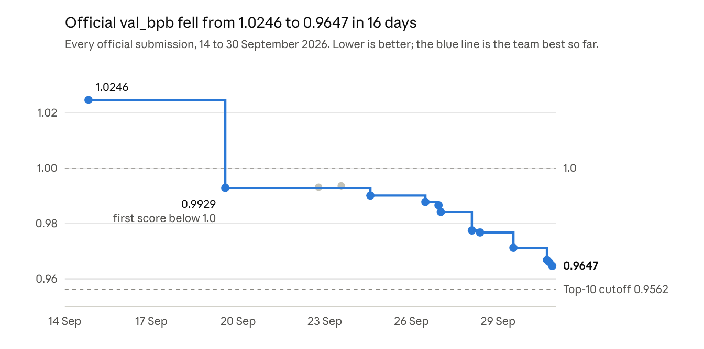

# AWS Trainium Frontier: Phase 1 Technical Writeup

1 October 2026 · Poojith Devan

We took the team's official val_bpb from 1.0246 to 0.9645, breaking 1.0 for the first time on 19 September. The model is a 113M-parameter transformer trained from scratch in 30 minutes on one Trainium2 chip, with custom NKI kernels. Our final score sits 0.0090 above the top-10 cutoff of 0.9555, a gap worth about 22% more effective training.

Team: Csaba Toth (team lead) and Poojith Devan.

## Score history

*Source: team submissions page on the competition portal; 16 official scores, 14 Sep to 1 Oct 2026, times in IST.*

Twelve of the 15 scored submissions from 19 September onward set a new team best, the last a re-run of the final file on 1 October. One more, on 30 September, failed at scoring; the fix is described below. Earlier submissions, from 6 to 13 September, scored between 1.038 and 1.159.

## What moved the score

Every change below was measured against a fixed baseline before we kept it. The two largest gains came from the model; most of the rest came from speed, which our runs convert at about 0.0004 bpb per 1% more steps.

| Change | What it does | Measured gain |
| --- | --- | --- |
| Hashed bigram table | A 262,144 x 256 table of token-pair features, with its own RMSprop update | 0.0054 bpb |
| Two-target objective | Predicts the next two tokens from shared logits, with no extra parameters | 0.0048 bpb |
| Graph clean-up | Removes redundant operations, for example one normalization instead of two | +4.9% steps, 0.0022 bpb |
| `--optlevel=3` | Compiler setting found by measurement; level 2 had been slower than level 1 | +4.7% throughput, 0.0018 bpb |
| Fused two-target CE kernel | One softmax pass and one combined gradient for both targets, in NKI | +3.0% steps |
| Flat weight cache and optimizer tail | One flat buffer for weights and optimizer state instead of per-parameter work | +1.4% steps |
| Kernel grid cap | Caps every NKI launch to the cores present (see the scoring crash below) | A failed submission became 0.9669 the same day |

## The engineering

The final model is an 8-layer dense transformer with custom kernels on every hot path. It trains for about 3,020 steps and 600M tokens in the 30 minutes, at about 342k tokens per second.

- **Backbone:** 8 layers x 1024 width, 8 heads x 128, ReLU² MLP (4096 wide), QK-norm, RoPE, 8,192-token vocabulary, 1,024-token context. Attention runs in 5 of the 8 layers, each fed by a 2-tap causal convolution; the other 3 layers have no attention.
- **Custom NKI kernels inside torch.compile:** fused RoPE + RMSNorm, fused softcap cross-entropy for two targets, the causal convolution, and the AWS nki-library flash attention (forward and backward) behind a custom autograd function.
- **Custom MLP backward:** saves only the ReLU output and recomputes the rest, cutting activation memory traffic.
- **Extra structure:** a gated value embedding in the last layer, the hashed bigram table, and U-Net-style scalar skip connections.
- **Optimizer:** Muon (Polar Express, NorMuon, cautious weight decay) for matrices and AdamW for the rest, sharded across the four ranks with one reduce-scatter and one all-gather per step.
- **Schedule:** batch size ramps from 131k to 262k tokens per step at one third of the run; learning rate warms down over the last 75%.

Evaluation is a plain causal forward at 1,024 context. Training and evaluation run the same code, with nothing that behaves differently at evaluation.

## The scoring crash and its fix

On 30 September a submission that trained cleanly on our machines failed on the platform with `INFRA_NEURON_CRASH` and no log. We found and fixed the cause the same day.

The scorer evaluates on a single NeuronCore (LNC=1), but our fused RoPE kernel launched on a two-core grid. Under LNC=1 that grid returned NaN instead of raising an error. Our earlier file never used a two-core grid at evaluation batch size, which is why it had scored.

The fix caps every NKI launch grid to the cores actually present, read from `NEURON_LOGICAL_NC_CONFIG`. Training under our LNC=2 command stays identical, and the fixed file gives the same bpb on one core and on the default setting, to the last digit.

The fixed file scored 0.9669 that afternoon. Any submission with multi-core NKI grids faces the same trap at scoring time.

## Where the wall is

Reaching the top 10 needed about 22% more effective training, and nothing we could build and verify in the time left came close.

- **Speed:** about 342k tokens per second at under 40% MFU. The step is limited by memory traffic: DMA engines are busy 87% of the time, and spills make up 57% of HBM bytes, more than twice the 25% level that AWS's profiler flags as excessive ([Neuron Explorer docs](https://github.com/aws-neuron/aws-neuron-sdk/blob/master/tools/neuron-explorer/overview-summary-page.rst)).
- **Exchange rate:** each 1% more training steps is worth about 0.0004 bpb in our runs.
- **The gap:** 0.0090 bpb to the top-10 cutoff of 0.9555, or about 22% more effective training.
- **The field:** the one top-10 team that published its recipe, Trainium of Thought, runs about 7% faster than we do (about 367k tokens per second). At our rate that edge is worth about 0.003, so speed alone does not explain the board ([their write-up](https://ritwikareddykancharla.github.io/projects/trainium-of-thought.html)).

Two routes have enough headroom: a fused MLP kernel that keeps the 4,096-wide hidden layer on chip, which attacks the spill traffic directly, or a sparse model that does less compute per token. Both are multi-week builds, out of reach inside Phase 1.

## What we ruled out

On the final night we tested 14 more ideas and four extra seeds across four machines, and none beat the final file. Quality results are bpb on our own runs against the final file's 0.9643 (a plus sign means worse); speed results are throughput against the same file.

| Experiment | Result |
| --- | --- |
| Progressive depth stacking (4 layers, then 8, mid-run) | +0.047 bpb |
| Optimizer and initialization bundle (five settings from recent speedrun records) | +0.006 bpb (two-seed mean 0.9705) |
| Asymmetric logit rescaling | +0.0012 bpb |
| Three-target objective | +0.0010 bpb |
| Shorter warmdown (50% instead of 75%) | +0.0010 bpb |
| Embedding learning rate x2 | +0.0006 bpb |
| Key-offset attention | +20% step time |
| `--disable-dge` | -21.5% throughput |
| Fused QKV projection | -5.0% throughput |
| Strided-DMA vectorization | -0.34% throughput |
| `--model-type=transformer` | -0.25% throughput |
| Host-sync packing | -0.13% throughput |
| Attention backward without mixed precision | +0.14% throughput, below our 1% bar |
| Sequence-length warmup (512, then 1,024 tokens) | Cold start 1,043 s, over the 900 s cap |
| Seeds 43 to 46 of the final file | 0.9649, 0.9752, 0.9657 and 0.9667 (seed 42: 0.9643) |

Earlier in the competition we also measured and closed batch-ramp variants, learning-rate, warmdown and momentum sweeps, LeakyReLU², weight averaging, bigram-table sizes and trigram features, width and depth changes, FP8 matmuls, micro-batch sizes, layout kernels, runtime flags, an 8-rank single-core layout, and attention in only 4 layers. Every candidate had to beat the baseline by more than our measured noise of about 0.0003 bpb.
